# Diagramas Técnicos del Sistema de Gestión de Horarios UNT

Este documento consolida todos los diagramas de arquitectura, componentes, secuencia, estados y modelo de datos del sistema **Scheduling UNT** representados utilizando la sintaxis de **Mermaid.js**.

---

## 1. Diagramas de Arquitectura

El sistema está estructurado bajo una arquitectura cliente-servidor clásica de tres capas (Presentación, Negocio, Datos), optimizada para la Web.

```mermaid
graph TD
    subgraph Frontend [Capa de Presentación (Frontend)]
        Vite[Vite Dev Server / Production Build]
        React[React.js SPA]
        Tailwind[Tailwind CSS (Estilos)]
        Axios[Axios (Cliente HTTP)]
        pdfJS[pdf.js / jsPDF / html2canvas (Exportador PDF)]
        
        React --> Tailwind
        React --> Axios
        React --> pdfJS
    end

    subgraph Backend [Capa de Negocio (Backend)]
        Express[Express.js App]
        Routes[Express Routes]
        Controllers[Express Controllers]
        Scheduler[Scheduler Service (Algoritmo)]
        Models[Models (SQL Directo)]
        PGPool[pg.Pool (Conexiones PostgreSQL)]
        
        Express --> Routes
        Routes --> Controllers
        Controllers --> Scheduler
        Controllers --> Models
        Scheduler --> Models
        Models --> PGPool
    end

    subgraph Database [Capa de Datos (Database)]
        PostgreSQL[(PostgreSQL DB)]
    end

    Axios -- "Peticiones HTTP (JSON)" --> Express
    PGPool -- "Consultas SQL" --> PostgreSQL
```

---

## 2. Diagrama de Casos de Uso del Negocio

Representación de los actores del negocio y los casos de uso principales (CUN) que definen los flujos operacionales del sistema de horarios.

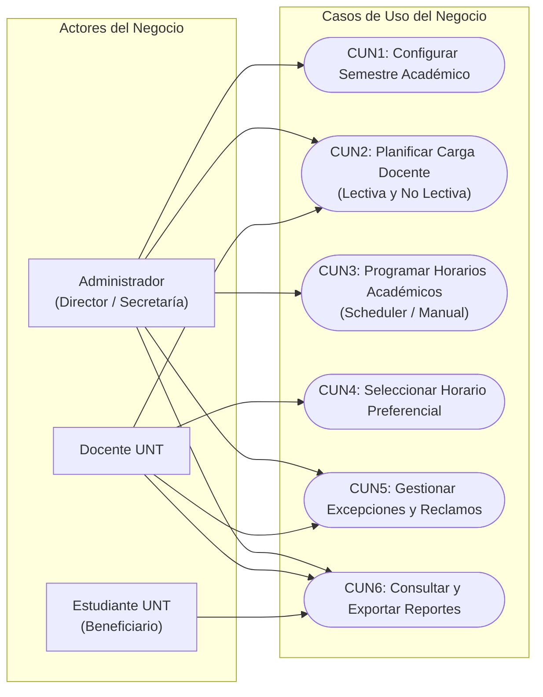

---

## 3. Modelo de Datos (ERD)

Diagrama de entidad-relación detallado con todas las tablas del esquema físico de la base de datos PostgreSQL, incluyendo las tablas de asignaciones, restricciones de horario, excepciones y carga no lectiva.

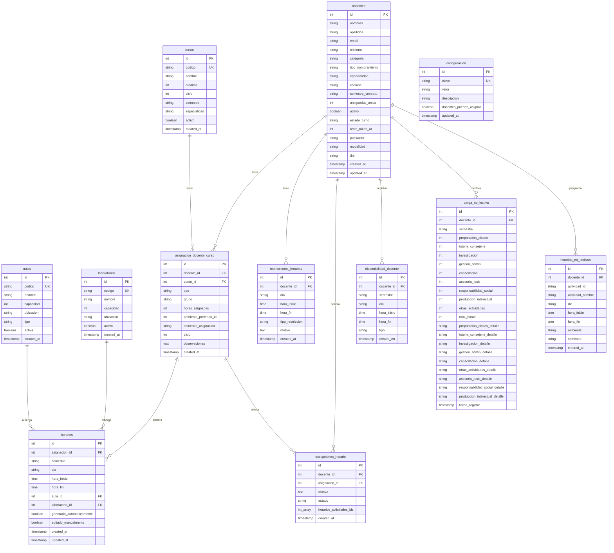

---

## 4. Diagrama de Componentes

Muestra la organización física de los componentes de código tanto en el Frontend (React) como en el Backend (Node/Express) y cómo se agrupan e interactúan.

```mermaid
graph TD
    subgraph Client_App [React Frontend App]
        Router[App Router - App.jsx]
        
        subgraph Views_Admin [Vistas Administrador]
            Dashboard[AdminDashboard.jsx]
            AdminDocentes[AdminDocentes.jsx]
            AdminAsignaciones[AdminAsignaciones.jsx]
            AdminAmbientes[AdminAmbientes.jsx]
            PlanificacionSecretaria[PlanificacionSecretaria.jsx]
            Reportes[Reportes.jsx]
        end

        subgraph Views_Docente [Vistas Docente]
            MiHorario[MiHorario.jsx]
            HorarioNoLectivo[HorarioNoLectivo.jsx]
            MisDisponibilidades[MisDisponibilidades.jsx]
            CargaHoraria[CargaHoraria.jsx]
        end

        subgraph Components [Componentes Compartidos]
            Navbar[Navbar.jsx]
            Layout[Layout.jsx]
        end

        subgraph Services_Frontend [Servicios de Comunicación y Utilidades]
            API_Client[api.js (Axios Instance)]
            pdfUtil[pdf.js (html2canvas + jsPDF)]
        end

        Router --> Views_Admin
        Router --> Views_Docente
        Views_Admin --> Components
        Views_Docente --> Components
        Views_Admin --> API_Client
        Views_Docente --> API_Client
        Reportes --> pdfUtil
        MiHorario --> pdfUtil
    end

    subgraph Server_App [Express Backend App]
        Server[Server.js / App.js]
        
        subgraph Routes_Backend [Rutas de la API]
            DocentesRoutes[docentes.routes.js]
            CursosRoutes[cursos.routes.js]
            AsignacionesRoutes[asignaciones.routes.js]
            HorariosRoutes[horarios.routes.js]
            ReportesRoutes[reportes.routes.js]
            SecretariaRoutes[secretaria.routes.js]
        end

        subgraph Controllers_Backend [Controladores HTTP]
            DocentesCtrl[docente.controller.js]
            CursosCtrl[curso.controller.js]
            AsignacionesCtrl[asignacion.controller.js]
            HorariosCtrl[horarios.controller.js]
            ReportesCtrl[reportes.controller.js]
            SecretariaCtrl[secretaria.controller.js]
        end

        subgraph Services_Backend [Servicios de Lógica de Negocio]
            SchedulerService[scheduler.service.js (Algoritmo)]
        end

        subgraph Models_Backend [Modelos de Acceso SQL]
            DocenteModel[docente.model.js]
            CursoModel[curso.model.js]
            AsignacionModel[asignacion.model.js]
            HorarioModel[horario.model.js]
            AulaModel[aula.model.js]
            LabModel[laboratorio.model.js]
        end

        Server --> Routes_Backend
        DocentesRoutes --> DocentesCtrl
        CursosRoutes --> CursosCtrl
        AsignacionesRoutes --> AsignacionesCtrl
        HorariosRoutes --> HorariosCtrl
        ReportesRoutes --> ReportesCtrl
        SecretariaRoutes --> SecretariaCtrl

        HorariosCtrl --> SchedulerService
        
        DocentesCtrl --> DocenteModel
        CursosCtrl --> CursoModel
        AsignacionesCtrl --> AsignacionModel
        HorariosCtrl --> HorarioModel
        ReportesCtrl --> HorarioModel
        SecretariaCtrl --> HorarioModel
        
        SchedulerService --> HorarioModel
        SchedulerService --> AulaModel
        SchedulerService --> LabModel
    end

    API_Client -- "Solicitudes HTTP (JSON)" --> Server
```

---

## 5. Diagramas de Secuencia (Todos los Casos de Uso)

A continuación se dejan los diagramas de secuencia de interacción para el 100% de los casos de uso:

### 5.1. Módulo de Autenticación y Seguridad

#### CU: Iniciar Sesión (JWT) y Validación de Credenciales
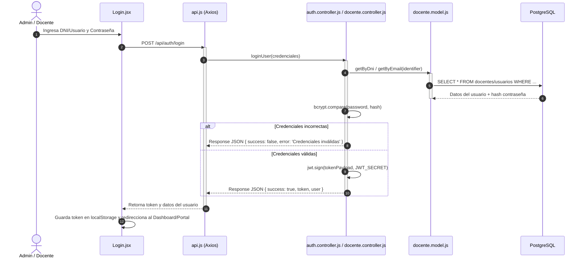

---

### 5.2. Módulo de Mantenimiento de Datos Maestros (CRUDs)

#### CU: Registrar/Editar/Eliminar Docente
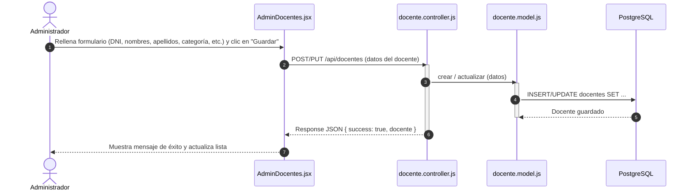

#### CU: Registrar/Editar/Eliminar Curso
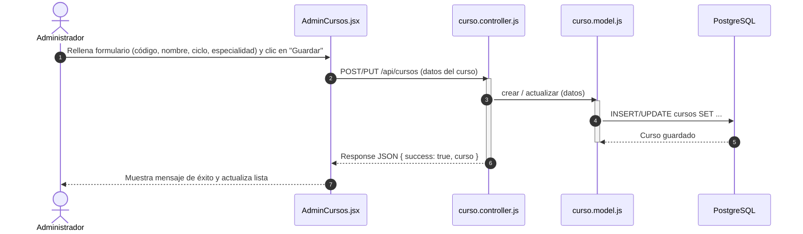

#### CU: Registrar/Editar/Eliminar Ambiente (Aulas/Laboratorios)
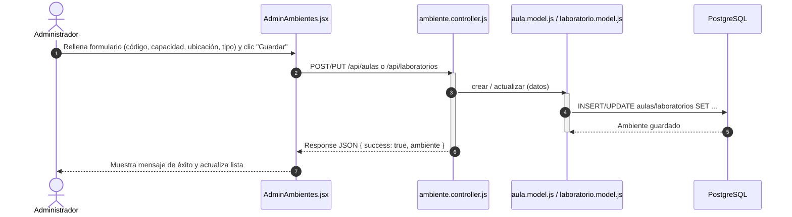

---

### 5.3. Módulo de Gestión de Asignaciones

#### CU: Registrar Asignación Docente-Curso Manual (con validaciones de especialidad y horas)
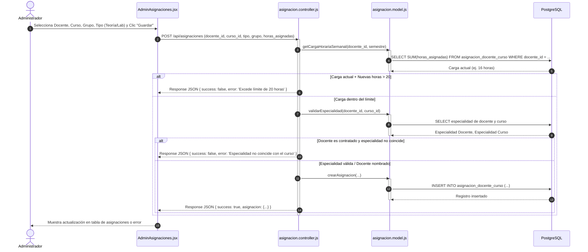

#### CU: Ejecutar Asignación Automática de Cursos
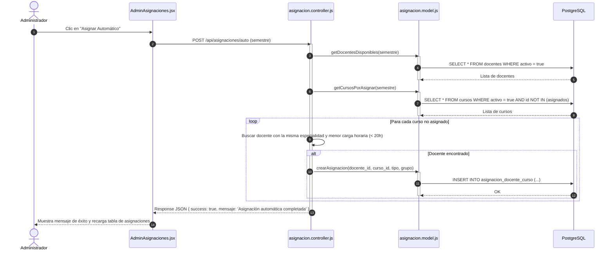

#### CU: Limpiar todas las asignaciones del semestre
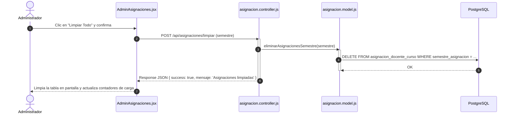

---

### 4.4. Módulo de Disponibilidad y Carga Docente

#### CU: Registrar Disponibilidad Horaria (Docente)
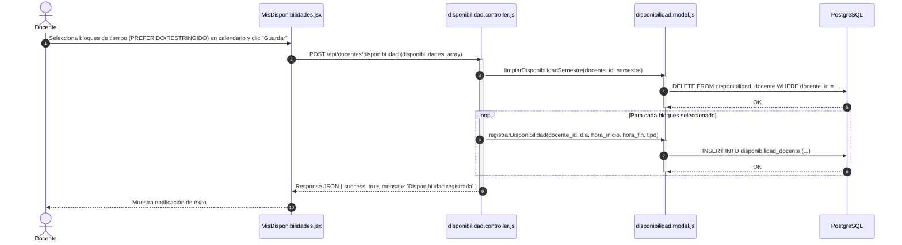

#### CU: Registrar Carga No Lectiva (Docente)
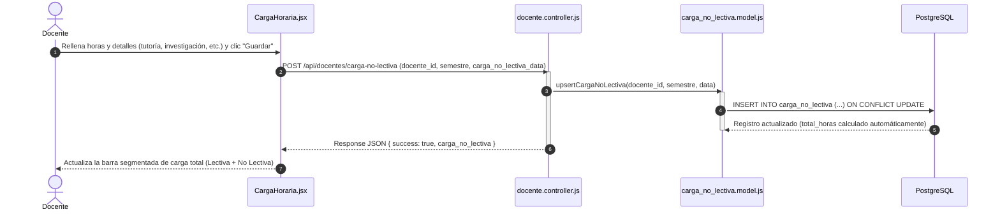

#### CU: Registrar Horario No Lectivo (Docente)
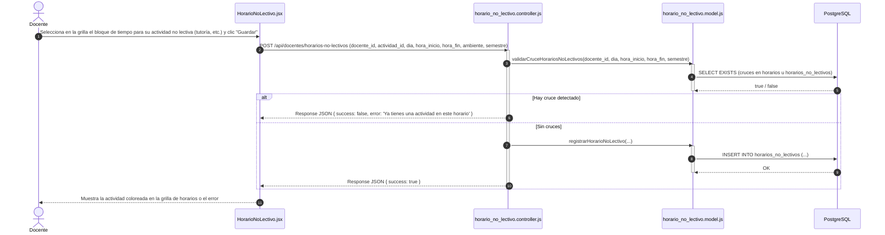

---

### 4.5. Módulo de Horarios (Programación)

#### CU: Generar Horarios Automáticamente (Scheduler)
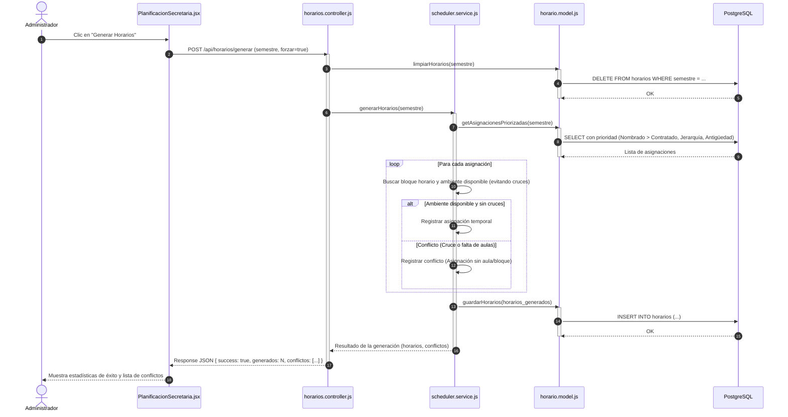

#### CU: Editar Horario Manualmente (Admin)
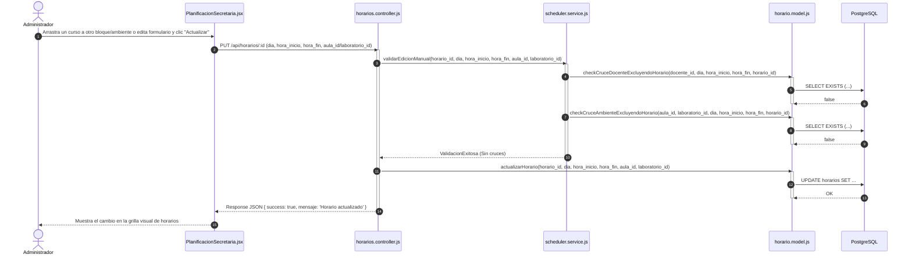

#### CU: Selección/Guardado de Horario por Docente
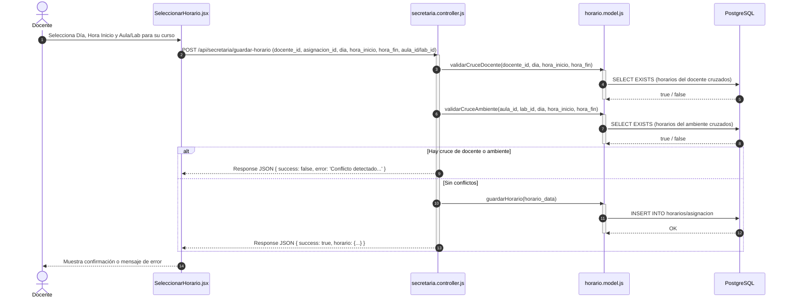

---

### 4.6. Módulo de Excepciones

#### CU: Solicitar Excepción de Horario (Docente)
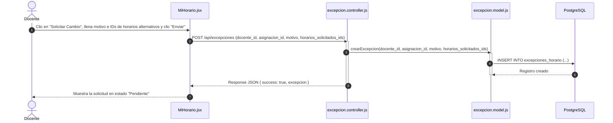

#### CU: Aprobar/Rechazar Excepción (Admin)
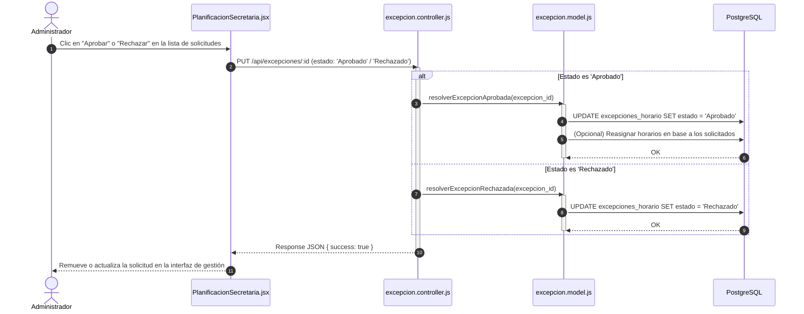

---

### 4.7. Módulo de Reportes y Estadísticas

#### CU: Consultar Estadísticas del Dashboard (Admin)
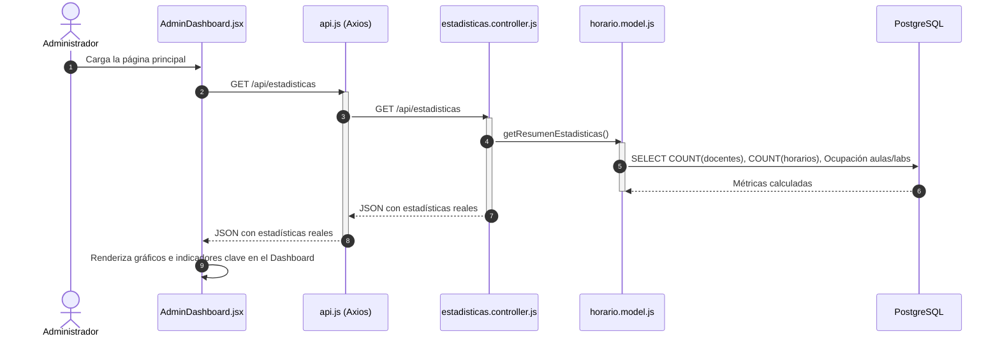

#### CU: Exportar Reportes a PDF (Operacional, Gestión e Individual)
```mermaid
sequenceDiagram
    autonumber
    actor User as Usuario (Admin / Docente)
    participant UI as Reportes.jsx / MiHorario.jsx
    participant api as api.js (Axios)
    participant Ctrl as reportes.controller.js
    participant DB as PostgreSQL
    participant pdf as pdf.js (Utilidad)

    User->>UI: Clic en "Exportar a PDF"
    UI->>api: GET /api/reportes/... (operacional, gestion, etc.)
    activate api
    api->>Ctrl: GET /api/reportes/...
    activate Ctrl
    Ctrl->>DB: SELECT JOINs de Horarios, Cursos, Docentes, Ambientes
    DB-->>Ctrl: Registros estructurados
    Ctrl-->>api: JSON con la data
    deactivate Ctrl
    api-->>UI: JSON con la data
    deactivate api
    
    UI->>UI: Renderiza plantilla HTML oculta (estilo Tailwind en DOM)
    UI->>pdf: exportElementToPDF(elemento_oculto_id, filename)
    activate pdf
    pdf->>pdf: html2canvas(elemento, { scale: 2 })
    pdf-->>pdf: Canvas de alta resolución (imagen del reporte)
    pdf->>pdf: New jsPDF(A4, portrait)
    loop Mientras falte contenido (alto de imagen > alto A4)
        pdf->>pdf: Agregar página e imprimir fragmento
    end
    pdf-->>UI: Descarga del archivo PDF (filename.pdf)
    deactivate pdf
    UI-->>User: Descarga completada con éxito
```

---

## 6. Diagramas de Estado (De Todas las Entidades)

A continuación se modela el ciclo de vida y las transiciones de estado para cada una de las 12 entidades del sistema utilizando etiquetas breves y directas sin comillas ni etiquetas HTML para evitar problemas de visualización e incompatibilidad en lectores Markdown.

### 6.1. Docentes (`docentes`)
Controla el ciclo de vida del docente, la asignación de carga, el envío de credenciales y el estado de su turno de selección en el semestre activo.
```mermaid
stateDiagram-v2
    state "SIN CARGA" as SinCarga
    state "CON CARGA LECTIVA" as ConCargaLectiva
    state "PENDIENTE" as Pendiente
    state "NOTIFICADO" as Notificado
    state "EN PROGRESO" as EnProgreso
    state "COMPLETADO" as Completado

    SinCarga : Docente registrado en el sistema
    ConCargaLectiva : Cursos y grupos lectivos fijados
    Pendiente : Cuenta creada esperando envio
    Notificado : Credenciales enviadas por Brevo
    EnProgreso : Registro de disponibilidad y carga no lectiva
    Completado : Turno bloqueado y carga consolidada

    [*] --> SinCarga : Inicio de Ciclo
    SinCarga --> ConCargaLectiva : Secretaria asigna carga lectiva
    ConCargaLectiva --> Pendiente : Secretaria genera accesos masivos
    Pendiente --> Notificado : notificarTodos()
    Notificado --> EnProgreso : Docente inicia sesion
    EnProgreso --> EnProgreso : Modifica preferencias o declaracion
    EnProgreso --> Completado : Secretaria cierra turno
    Completado --> [*] : Cierre de Semestre
```

### 6.2. Cursos (`cursos`)
Controla la disponibilidad del curso para ser asignado en semestres activos.
```mermaid
stateDiagram-v2
    [*] --> Activo : Crear
    Activo --> Asignado : Asignar docente
    Asignado --> Programado : Programar horario
    Programado --> Activo : Limpiar horario
    Asignado --> Activo : Quitar asignacion
    Activo --> Inactivo : Desactivar
    Inactivo --> Activo : Reactivar
    Inactivo --> [*] : Dar de baja
```

### 6.3. Aulas (`aulas`)
Ciclo de ocupación física de un aula teoría/práctica.
```mermaid
stateDiagram-v2
    [*] --> Activa : Crear
    Activa --> Reservada : Asignar clase
    Reservada --> Activa : Liberar bloque
    Activa --> Inactiva : Mantenimiento
    Inactiva --> Activa : Habilitar
    Inactiva --> [*] : Dar de baja
```

### 6.4. Laboratorios (`laboratorios`)
Ciclo de ocupación física de laboratorios de cómputo/general.
```mermaid
stateDiagram-v2
    [*] --> Activo : Crear
    Activo --> Reservado : Asignar clase
    Reservado --> Activo : Liberar bloque
    Activo --> Inactivo : Mantenimiento
    Inactivo --> Activo : Habilitar
    Inactivo --> [*] : Dar de baja
```

### 6.5. Configuración (`configuracion`)
Estados de guardado de los parámetros operacionales del sistema.
```mermaid
stateDiagram-v2
    [*] --> Por_Defecto : Inicializar
    Por_Defecto --> Modificada : Editar parametros
    Modificada --> Guardada : Persistir en BD
    Guardada --> Modificada : Editar nuevamente
```

### 6.6. Asignación Docente-Curso (`asignacion_docente_curso`)
Controla la carga horaria vinculando el plantel con los cursos en un semestre activo.
```mermaid
stateDiagram-v2
    [*] --> Creada_Sin_Horario : Asignar
    Creada_Sin_Horario --> Programada : Programar
    Programada --> En_Conflicto : Reportar cruce
    En_Conflicto --> Programada : Reprogramar
    Programada --> Creada_Sin_Horario : Limpiar horario
    Creada_Sin_Horario --> [*] : Eliminar
```

### 6.7. Horarios (`horarios`)
Controla el estado de programación de un bloque de clase (generación automática o edición manual).
```mermaid
stateDiagram-v2
    [*] --> Generado_Automatico : Generacion automatica
    [*] --> Creado_Manual : Creacion manual
    Generado_Automatico --> Editado_Manual : Edicion manual
    Creado_Manual --> Editado_Manual : Edicion manual
    Generado_Automatico --> Confirmado : Oficializar
    Editado_Manual --> Confirmado : Oficializar
    Confirmado --> [*] : Cerrar ciclo
    Generado_Automatico --> [*] : Eliminar horario
    Editado_Manual --> [*] : Eliminar horario
```

### 6.8. Restricciones Horarias (`restricciones_horarias`)
Define la inamovibilidad o exclusión de rangos de horas para docentes.
```mermaid
stateDiagram-v2
    [*] --> Registrada : Crear
    Registrada --> Aplicada : Procesar
    Aplicada --> Inactiva : Cambiar disponibilidad
    Registrada --> Inactiva : Eliminar
```

### 6.9. Excepciones de Horario (`excepciones_horario`)
Estados del proceso de reconsideración de un bloque de horario asignado.
```mermaid
stateDiagram-v2
    [*] --> Pendiente : Solicitar
    Pendiente --> Aprobada : Aprobar
    Pendiente --> Rechazada : Rechazar
    Aprobada --> [*] : Finalizar
    Rechazada --> [*] : Finalizar
```

### 6.10. Disponibilidad Docente (`disponibilidad_docente`)
Ciclo de vida de las preferencias horarias declaradas por un profesor.
```mermaid
stateDiagram-v2
    [*] --> Registrada : Guardar
    Registrada --> Evaluada_Scheduler : Leer disponibilidad
    Evaluada_Scheduler --> Sobrescrita : Actualizar disponibilidad
    Sobrescrita --> Registrada : Guardar
    Registrada --> Eliminada : Limpiar
    Eliminada --> [*] : Finalizar
```

### 6.11. Carga No Lectiva (`carga_no_lectiva`)
Ciclo de vida del registro de horas de actividades no lectivas.
```mermaid
stateDiagram-v2
    [*] --> Creada : Inicializar
    Creada --> Actualizada : Guardar actividades
    Actualizada --> Total_Recalculado : Calcular total
    Total_Recalculado --> Actualizada : Editar carga
```

### 6.12. Horarios No Lectivos (`horarios_no_lectivos`)
Programación de bloques de carga no lectiva en la grilla horaria del docente.
```mermaid
stateDiagram-v2
    [*] --> Planificado : Seleccionar
    Planificado --> Validado : Validar cruces
    Validado --> Guardado : Guardar
    Guardado --> Modificado : Mover bloque
    Modificado --> Validado : Revalidar
    Guardado --> Eliminado : Eliminar
    Eliminado --> [*] : Finalizar
```
